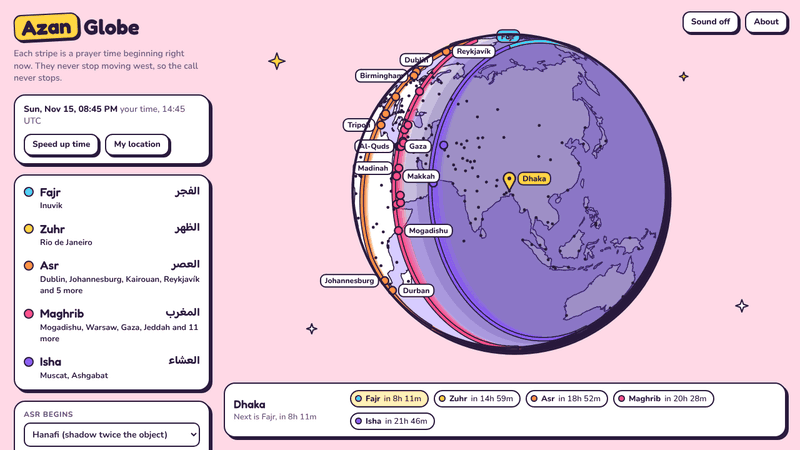
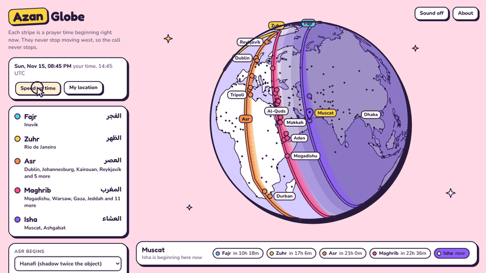

# Azan Globe

A live globe that shows where each of the five daily prayers is beginning right now. The lines never stop moving west, so somewhere on Earth the Azan is always being called.

**Live:** https://muntaha-islam0019.github.io/azan-globe/

## What it does

- Draws a line for each prayer (Fajr, Zuhr, Asr, Maghrib, Isha) where it is beginning at this moment. Stripes trail each line for 20 minutes, roughly the window in which mosques there are calling the Azan.
- Click anywhere to pin it and see how long until each prayer begins at that exact spot. Click a prayer name to jump to its line.
- **My location** asks the browser where you are and pins it. The position is used only on the page. It is never stored or sent anywhere. If you decline, it falls back to the city of your time zone.
- **Speed up time** runs the clock at 30 minutes per second.
- Asr can follow the Hanafi rule (shadow twice the object) or the Shafi'i, Maliki and Hanbali rule (shadow equal). Fajr and Isha can use the Karachi, Muslim World League, Egyptian or ISNA angles. The defaults are Hanafi and Karachi.
- With sound on, the Azan fades in whenever the pinned place is inside a stripe.
- Near the poles a line stops where its sign in the sky does not happen that day, and the About panel explains how Muslims there pray.

## How it works

There is no server and no prayer-time API. Everything is calculated in the browser from the position of the sun:

- **Fajr** and **Isha**: the sun a set angle below the horizon (18 degrees for the Karachi method).
- **Zuhr**: just after the sun crosses its highest point.
- **Asr**: when a shadow reaches the set length on top of its noon length.
- **Maghrib**: sunset, the edge between day and night.

The whole app is a single `index.html`. The globe is drawn on a canvas with d3-geo.

## Credits

- [D3](https://d3js.org) (ISC licence)
- Land outlines: [Natural Earth](https://www.naturalearthdata.com) (public domain), via [world-atlas](https://github.com/topojson/world-atlas)
- Time zone cities: the [IANA time zone database](https://www.iana.org/time-zones) (public domain)
- Fonts: Fredoka, Nunito and Baloo Bhaijaan 2 from Google Fonts (SIL Open Font License)
- Azan recording: to be added

## Licence

Copyright (c) 2026 Md. Muntaha Islam. All rights reserved. The code is public to view, not to reuse. See [LICENSE](LICENSE).
